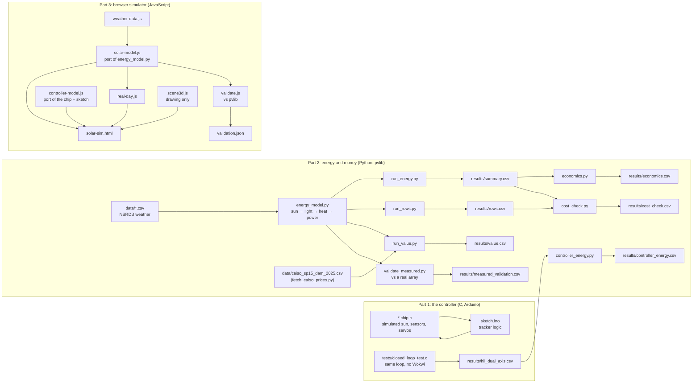

# Project map

What every file does, how the pieces connect, and the order to read them in. Use it to find
the code behind any number in the README or on the website.

## The pipeline

## Files

### Part 1: the controller

| File | What it does |
|---|---|
| `single-axis/wokwi/sketch.ino` | The tracker's control loop: read two light sensors every 30 ms, compare them, step the servo 1°. Raw mode uses a 10-count threshold; filtered mode averages 20 readings and uses a 40-count deadband. |
| `single-axis/wokwi/sun-sensor-head.chip.c` | The "outside world" for Wokwi: decodes the servo's PWM pulse, moves the panel at SG90 speed, computes how much light each sensor sees behind the divider wall, adds clouds and flicker, and turns light into a voltage. |
| `dual-axis/wokwi/*` | The same for two axes (pan and tilt, four sensors). |
| `*/tests/closed_loop_test.c` | Runs the chip and the sketch's logic together in plain C, fast, with no Wokwi. Produces the move and reversal counts (`make test`). |
| `common/wokwi-api.h` | Wokwi's custom-chip interface. |

### Part 2: energy and money

| File | What it does | Writes |
|---|---|---|
| `energy_model.py` | The core physics, one function per step: load weather, panel orientation for each mount, sunlight on the panel (Perez), glass reflection, cell temperature (SAPM), DC power (CEC single diode), inverter (Sandia). Also trackers in rows (`single_axis_in_rows`). | none |
| `run_energy.py` | Runs every setup at both sites, finds the best fixed tilt, checks other weather versions and the cost of pointing error. | `summary.csv`, `monthly.csv`, `tilt_sweep.csv`, `pointing_error.csv`, … |
| `run_rows.py` | Single axis trackers in rows: shading between rows, with and without backtracking, for row spacings from 0.20 to 0.60. | `rows.csv` |
| `economics.py` | Break-even tracker price: present value over 25 years of (extra kWh × price − extra upkeep). | `economics.csv` |
| `cost_check.py` | Compares the farm break-even with the three published tracker prices, across contract prices and discount rates. | `cost_check.csv` |
| `fetch_caiso_prices.py` | Downloads 2025 hourly California prices (run on a machine that can reach CAISO). | `data/caiso_sp15_dam_2025.csv` |
| `run_value.py` | Prices every hour of output at Daggett, CA with those prices: revenue, capture price, break-even three ways. | `value.csv`, `value_by_hour.csv` |
| `validate_measured.py` | Runs the model against 7 years of a real NREL array. | `measured_validation.csv` |
| `controller_energy.py` | Turns the controller's pointing error into energy lost over a year. | `controller_energy.csv` |
| `make_figures.py` | The PNG charts in `figures/`. | `figures/*.png` |

### Part 3: browser simulator

| File | What it does |
|---|---|
| `solar-model.js` | A smaller copy of `energy_model.py` that runs in a browser. Uses PVWatts equations instead of the single diode and Sandia models. |
| `weather-data.js` | Hourly weather for both sites plus the module, inverter and loss settings, exported from the Python model. |
| `controller-model.js` | A copy of the single axis chip and sketch, stepped 1 ms at a time. |
| `real-day.js` | Runs the controller on a real day's sun path and clouds and measures the energy and motor cost. |
| `scene3d.js` | The 3D view (three.js). Drawing only; every number comes from `solar-model.js`. |
| `validate.js` (+ `check-*.json`, `export_rows_reference.py`) | Checks the browser model against pvlib. Writes `validation.json`. |
| `solar-sim.html`, `style.css` | The page. |

## Where each headline number comes from

| Claim | File | Produced by |
|---|---|---|
| Reversals 749 → 7 | `energy-yield/results/hil_dual_axis.csv` | `dual-axis/tests/closed_loop_test.c` |
| +25% (Phoenix, single axis alone) | `results/summary.csv` | `run_energy.py` |
| +19% in farm rows | `results/rows.csv` | `run_rows.py` |
| Home break-even $0.57/W | `results/economics.csv` | `economics.py` |
| Farm rows $0.10/W vs $0.11/W | `results/cost_check.csv` | `cost_check.py` |
| +19% energy, +34% revenue | `results/value.csv` | `run_value.py` |
| Within 2% of a real array | `results/measured_validation.csv` | `validate_measured.py` |
| Worst controller loses 0.17% | `results/controller_energy.csv` | `controller_energy.py` |
| Browser model within 0.6% of pvlib | `web-sim/validation.json` | `web-sim/validate.js` |

## Reading order for learning the code

1. **`energy_model.py`, top to bottom.** Every result depends on it. Question to answer: what are the six steps from sunlight to AC power, and which published model does each step use?
2. **`run_energy.py`.** How the model is run for each setup. Question: how is the "best tilt" found?
3. **`economics.py`.** Question: write the break-even formula on paper, and explain why a home and a farm reach different answers.
4. **`run_rows.py` and `single_axis_in_rows`.** Question: what does backtracking do to the tracker angle, and why does it beat pointing at the sun?
5. **`run_value.py`.** Question: what is a capture price, and why can extra energy be worth more than its share?
6. **`validate_measured.py`.** Question: what do tests A, B and C each check?
7. **`single-axis/wokwi/sketch.ino`, then the chip.** Question: what exactly do the moving average and the deadband change?
8. **`web-sim/solar-model.js`.** Compare it with `energy_model.py` step by step.

## Known gaps

* `web-sim/weather-data.js` was exported with a one-off script that is not in this repository. Its contents can be checked against `data/*.csv` and `results/summary.csv`, but regenerating it is not yet one command.
* The website's case study page lives with the website, not here. Every number in it comes from a file listed above.
