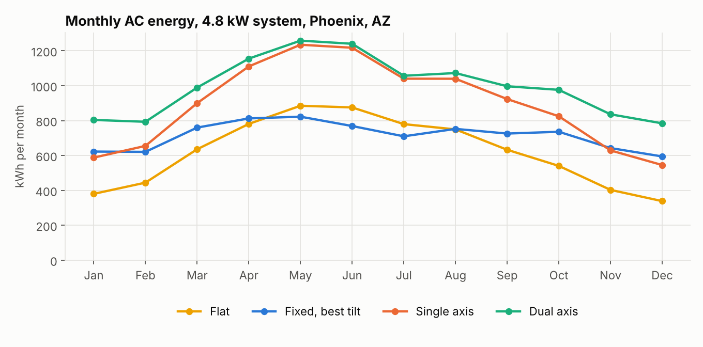
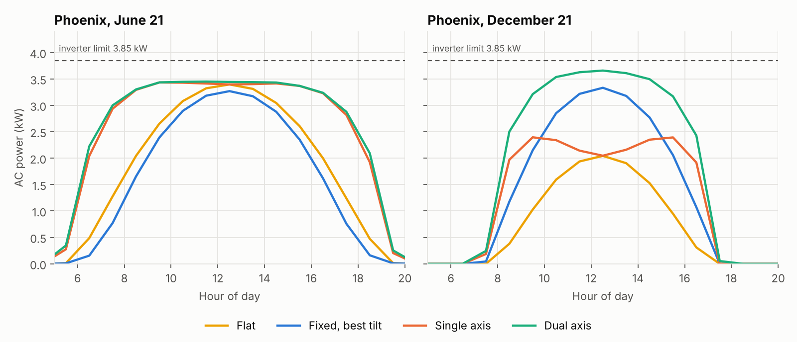
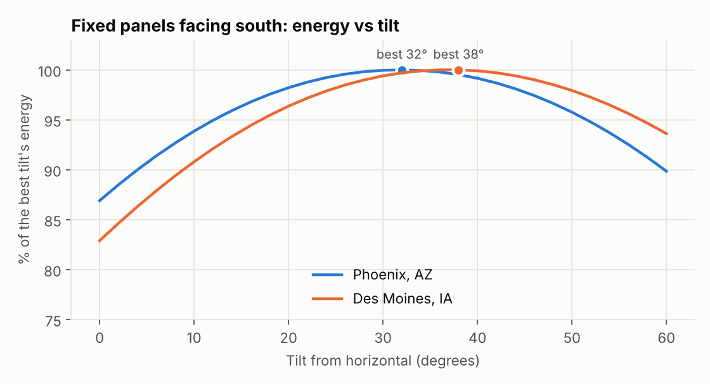
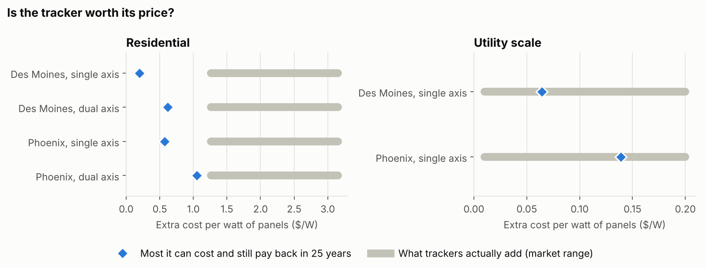

# Energy yield and economics: is solar tracking worth it?

Tilting and tracking increase a solar panel's output, but whether they are worth it
depends on cost, maintenance, motor energy, latitude, and how much of the sunlight is
direct rather than diffuse. This model asks:

1. How much extra energy do tilt, single axis tracking and dual axis tracking produce?
2. How does that gain change between a sunny desert (Phoenix) and a cloudier, more northern site (Des Moines)?
3. Does the extra energy pay for the tracker, for a home and for a solar farm?
4. How much does the tracking controller itself matter? (This connects to the hardware-in-the-loop simulation in the rest of this repo.)

Built with [pvlib](https://pvlib-python.readthedocs.io), NREL NSRDB typical-year weather data,
and real equipment from the CEC database used by NREL's tools.

## Answer in brief

| | Phoenix, AZ | Des Moines, IA |
|---|---|---|
| Diffuse share of sunlight | 23% | 41% |
| Best fixed tilt | 32° | 38° |
| Fixed tilt vs flat | **+15%** | **+21%** |
| Single axis vs fixed tilt | **+25%** | **+18%** |
| Dual axis vs fixed tilt | **+40%** | **+35%** |
| Home tracker pays off? | No | No |
| Utility single axis tracker pays off? | Yes, at 2025 prices | Only if very cheap |

* **Tilt is almost free energy,** and it matters more the farther you go from the equator.
* **For homes, trackers don't pay off.** In Phoenix the extra energy justifies at most $0.57/W extra for single axis (or $1.05/W for dual axis) over 25 years, while trackers add $1.26 to $3.15/W to a home system.
* **For solar farms, single axis tracking pays off because it's now nearly free.** In 2025, US projects with trackers cost $1.31/W DC vs $1.30/W DC for fixed racking (Berkeley Lab). The extra energy in Phoenix would justify up to $0.14/W. This is why 96% of new US utility solar capacity in 2025 used single axis trackers.
* **The controller barely matters for energy, but it matters for wear.** Even the worst light-sensor controller loses under 0.2% of a year's energy, but the unfiltered one moves the motors 12 times as often as a controller that calculates the sun's position.

## System

| Item | Choice |
|---|---|
| Modules | 12 × Canadian Solar CS1U-400MS (400 W mono-Si), 2 strings of 6 = 4.81 kW DC |
| Inverter | SMA Sunny Boy 3.8 (3.85 kW AC), DC/AC ratio 1.25 |
| Losses | 14.08% (PVWatts defaults: soiling, shading, mismatch, wiring, connections, LID, nameplate, availability) |
| Mounting | Open rack (SAPM glass/polymer thermal model) |
| Single axis tracker | Horizontal north-south axis, ±60° rotation, no backtracking |
| Dual axis tracker | Faces the sun exactly (or with a set pointing error, for stage 2) |

String size: 6 modules keep the cold-morning open circuit voltage (about 343 V) under
the inverter's 480 V limit, and the hot-afternoon operating voltage above its 195 V minimum.

## Weather data

| Site | File | Notes |
|---|---|---|
| Phoenix, AZ | NSRDB TMY 2025 (`data/nsrdb/phoenix_tmy-2025.csv`) | Newest typical year, months drawn from 2001–2023. Timestamps are UTC and are converted to local standard time |
| Des Moines, IA | NSRDB PSM v3 TMY from NREL SAM's sample files | Stand-in for the upper Midwest. No ground reflectivity column, so albedo is set to 0.2 |

A **typical meteorological year (TMY)** stitches together the most average version of each
month from about 20 years of satellite data, so results describe a normal year rather than
one unusually sunny or cloudy year.

**Does the choice of data matter?** Phoenix was run with five versions of the data:

| Dataset | Sunlight (GHI, kWh/m²) | Fixed (kWh/yr) | Single axis gain | Dual axis gain |
|---|---|---|---|---|
| SAM sample (PSM v3) | 2,115 | 8,590 | 24.9% | 39.8% |
| NSRDB TMY 2022 | 2,130 | 8,605 | 25.8% | 40.8% |
| NSRDB TMY 2023 | 2,115 | 8,507 | 25.4% | 40.0% |
| NSRDB TMY 2024 | 2,141 | 8,588 | 24.9% | 39.6% |
| **NSRDB TMY 2025** | **2,131** | **8,567** | **25.0%** | **39.6%** |
| NSRDB TDY 2025 (direct-weighted) | 2,137 | 8,576 | 24.9% | 39.6% |

The tracking gain moves by less than one percentage point across datasets, so the conclusions don't depend on which file is used.

## Model chain

Every hour of the year:

| Step | What it calculates | pvlib function |
|---|---|---|
| 1 | Sun position | `Location.get_solarposition` |
| 2 | Panel orientation (flat, fixed, single axis, dual axis) | `tracking.singleaxis` |
| 3 | Light on the tilted panel (Perez sky model, ground reflection) | `irradiance.get_total_irradiance` |
| 4 | Light reflected off the glass at steep angles | `iam.physical`, `iam.marion_diffuse` |
| 5 | Cell temperature from sun, air temperature and wind | `temperature.sapm_cell` |
| 6 | DC power from the module's single diode model | `calcparams_cec`, `max_power_point` |
| 7 | System losses | `pvwatts_losses` |
| 8 | AC power, inverter efficiency and clipping | `inverter.sandia` |

## 1. Energy

| | Flat | Fixed | Single axis | Dual axis |
|---|---|---|---|---|
| **Phoenix:** AC energy (kWh/yr) | 7,445 | 8,567 | 10,707 | 11,961 |
| Per kW installed (kWh/kW) | 1,549 | 1,783 | 2,228 | 2,489 |
| Capacity factor (DC basis) | 17.7% | 20.4% | 25.4% | 28.4% |
| **Des Moines:** AC energy (kWh/yr) | 5,407 | 6,523 | 7,686 | 8,789 |
| Per kW installed (kWh/kW) | 1,125 | 1,358 | 1,600 | 1,829 |
| Capacity factor (DC basis) | 12.8% | 15.5% | 18.3% | 20.9% |





* **The best fixed tilt follows latitude:** 32° in Phoenix (latitude 33.5°) and 38° in Des Moines (41.6°). The optimum is broad: anything within about 10° of it gives at least 98.5% of the best.
* **Tracking gains less where the sky is hazier.** Single axis tracking gains 25% in Phoenix but only 18% in Des Moines, where 41% of the light is diffuse and arrives from the whole sky.
* **Single axis tracking loses to fixed tilt from November to January in Phoenix.** The horizontal axis leaves the panel nearly flat at noon, a poor angle for the low winter sun.
* **A flat panel beats a tilted one in early summer,** when the sun is nearly overhead at noon.
* **Validation:** swapping in NREL's simpler PVWatts equations for the DC, temperature and inverter steps changes every result by less than 1.5%.




## 2. Economics

Rather than guess one tracker price, the model calculates the **break-even premium**: the
most extra a tracker could cost per watt and still pay for itself over 25 years. That is
then compared with what trackers really add to a system's cost.

> break-even premium ($/W) = present value over 25 years of (extra kWh × value of electricity − extra maintenance)

| Assumption | Residential | Utility scale | Source |
|---|---|---|---|
| Value of electricity | $0.15/kWh (avoided retail price) | $0.030/kWh ($30/MWh PPA) | EnergySage Arizona average, Nov 2026; Berkeley Lab Utility-Scale Solar 2026 (PPAs $25–35/MWh in the West) |
| Base system cost | $3.15/W DC | $1.30/W DC | NREL Q1 2024 PV cost benchmark; Berkeley Lab 2026 (2025 fixed-tilt projects) |
| What a tracker adds | 40–100% of system cost ($1.26–3.15/W) | $0.01/W (2025) to $0.20/W (2023 data) | EnergySage; Berkeley Lab |
| Extra maintenance | $20/kW per year | $2/kW per year | Assumption |
| Life, discount rate, degradation | 25 years, 6%, 0.5%/yr | same | Assumption |

| Case | Extra energy | Break-even premium | Market premium | Simple payback | Verdict |
|---|---|---|---|---|---|
| Phoenix home, single axis | +445 kWh/kW | $0.57/W | $1.26–3.15/W | 27–67 years | Does not pay off |
| Phoenix home, dual axis | +706 kWh/kW | $1.05/W | $1.26–3.15/W | 15–37 years | Does not pay off (closest) |
| Des Moines home, single axis | +242 kWh/kW | $0.20/W | $1.26–3.15/W | 77+ years | Does not pay off |
| Des Moines home, dual axis | +471 kWh/kW | $0.62/W | $1.26–3.15/W | 25–62 years | Does not pay off |
| Phoenix solar farm, single axis | +445 kWh/kW | $0.14/W | $0.01–0.20/W | 0.9–18 years | Pays off at 2025 prices |
| Des Moines solar farm, single axis | +242 kWh/kW | $0.06/W | $0.01–0.20/W | 1.9–38 years | Pays off only if very cheap |



Why homes and solar farms reach opposite answers: a home values each kWh about five times
more ($0.15 vs $0.03), but a home tracker is a custom pole-mounted structure that costs
more than the energy is worth, while a utility tracker is a mass-produced row of steel that
now costs about the same as fixed racking.

## 3. Does the controller matter?

The dual axis hardware-in-the-loop simulation (`dual-axis/tests`) measures each
controller's pointing error and motor activity over one time-lapse day. Here those errors
are converted into a year of lost energy using the Phoenix dual axis model:

| Controller | Average pointing error | Energy lost per year | Servo moves | Reversals |
|---|---|---|---|---|
| Calculated sun position (cloudy) | 0.3° | 0.00% | 252 | 3 |
| Light sensors (clear sky) | 1.6° | 0.03% | 359 | 3 |
| Light sensors, raw (cloudy) | 2.2° | 0.06% | 2,966 | 749 |
| Light sensors, filtered (cloudy) | 3.9° | 0.17% | 409 | 7 |


Because the panel's output falls with the cosine of the pointing error, a few degrees off
costs almost nothing (cos 4° = 0.998). The real cost of a noisy controller is motor wear
and reliability: the raw light-sensor controller moves the servos 12 times as often as
one that simply calculates where the sun is. That is why commercial trackers mostly
calculate the sun's position from time and location, and use sensors only to confirm the
panel's angle.

## Running it

```
pip install -r requirements.txt
python run_energy.py          # energy for both sites, dataset check, pointing error curve
python economics.py           # break-even premiums and payback
python controller_energy.py   # combines the controller simulation with the energy model
python make_figures.py        # writes figures/*.png
```

`results/hil_dual_axis.csv` comes from `cd ../dual-axis/tests && make && ./closed_loop_test --csv`.

## Limitations

* One typical year per site. Real years vary by a few percent.
* No row-to-row shading, so the single axis tracker does not backtrack. Utility arrays with close rows would gain somewhat less.
* Losses use PVWatts defaults rather than measured values, and module degradation is a flat 0.5% per year.
* Electricity is valued at a flat price. Real tariffs and wholesale prices vary by hour, and trackers produce more in the late afternoon, when power is often worth more, which this model does not credit.
* Residential tracker costs come from a broad consumer-guide range, and the extra maintenance costs are assumptions.
* The controller comparison uses a time-lapse day, a 45° latitude sun path, and modeled cloud and flicker noise.
