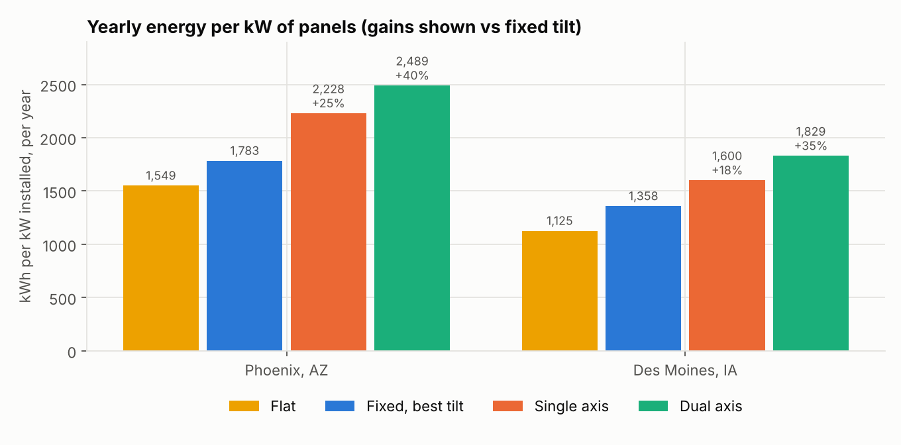
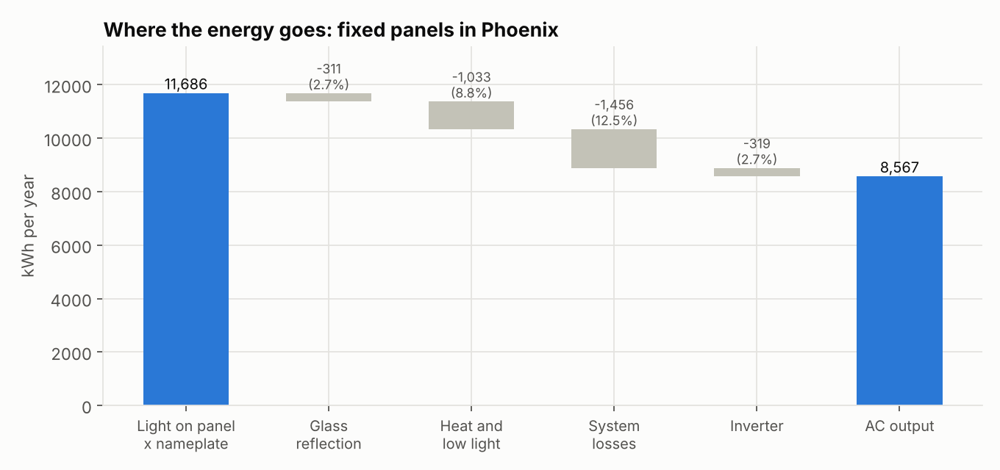
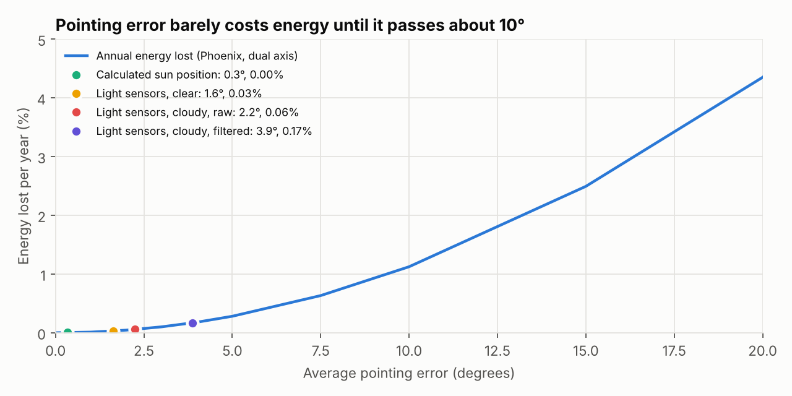
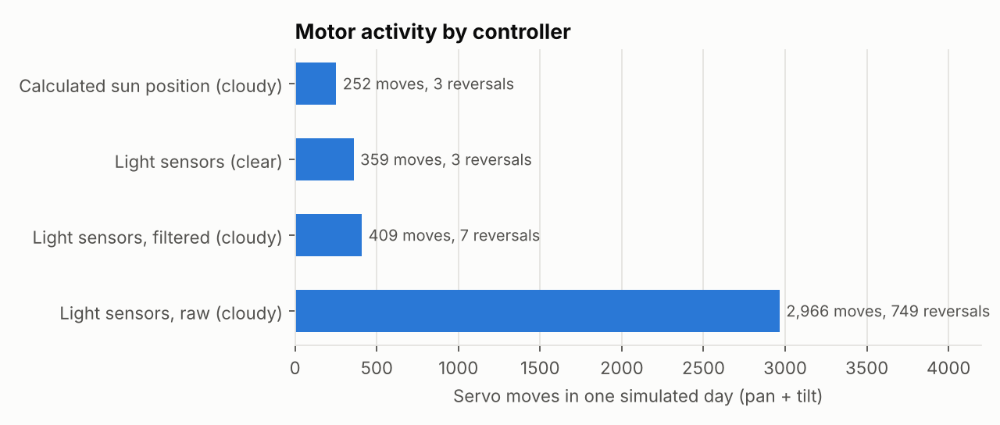

# Energy yield and economics: is solar tracking worth it?

Tilting and tracking increase a solar panel's output, but whether they are worth it
depends on cost, maintenance, motor energy, latitude, and how much of the sunlight is
direct rather than diffuse. This model asks:

1. How much extra energy do tilt, single axis tracking and dual axis tracking produce?
2. How does that gain change between a sunny desert (Phoenix) and a cloudier, more northern site (Des Moines)?
3. Does the extra energy pay for the tracker, for a home and for a solar farm?
4. How much does the tracking controller itself matter? (This connects to the hardware-in-the-loop simulation in the rest of this repo.)

Built with pvlib,[^pvlib] NSRDB typical-year weather data,[^nsrdb] and equipment from the
CEC module and inverter databases that NREL's System Advisor Model and pvlib use.[^cec-db]

> **How claims are backed.** Each statement is a published source (footnoted), a result
> from this folder (footnoted with the file), or an assumption (labeled). All references:
> [`../SOURCES.md`](../SOURCES.md).

## Answer in brief

| | Phoenix, AZ | Des Moines, IA |
|---|---|---|
| Diffuse share of sunlight | 23% | 41% |
| Best fixed tilt | 32° | 38° |
| Fixed tilt vs flat | **+15%** | **+21%** |
| Single axis vs fixed tilt | **+25%** | **+18%** |
| Dual axis vs fixed tilt | **+40%** | **+35%** |
| Home tracker pays off? | No | No |
| Utility single axis tracker pays off on energy alone? | Roughly even: in farm rows, worth $0.10/W vs a $0.11/W like-for-like price | No: worth $0.03/W in rows |

Energy rows: [`results/summary.csv`](results/summary.csv). Verdicts: [`results/economics.csv`](results/economics.csv) and [`results/cost_check.csv`](results/cost_check.csv).

* **Tilting adds 15 to 21% over lying flat,** and the gain was larger at the more northern site.[^r-summary]
* **For homes, trackers don't pay off.** In Phoenix the extra energy justifies at most $0.57/W extra for single axis (or $1.05/W for dual axis) over 25 years,[^r-econ] while trackers add 40 to 100% to a system's cost,[^es-trackers] or $1.26 to $3.15/W on a $3.15/W home system.[^nrel-bench]
* **For solar farms, the extra energy roughly breaks even with the tracker's cost.** In realistic rows that backtrack (part 4), the extra energy in Phoenix is worth $0.10/W over 25 years.[^r-rows] SEIA and Wood Mackenzie's like-for-like 2026 price puts single axis tracking at $0.11/W more than fixed tilt.[^seia-q3] Phoenix rows break even in only 3 of 9 combinations of contract price and discount rate, and Des Moines in none.[^r-cost] Berkeley Lab's much lower $0.01/W compares different projects and does not control for size or location.[^lbl2026] See "Which tracker price?" below.
* **That left a puzzle, which part 6 answers.** 96% of new US utility solar capacity in 2025 used single axis trackers.[^lbl2026] When a model disagrees with an industry, the model is probably missing something. The likeliest gap is timing: this model values every kWh the same, but tracking shifts output toward higher-priced morning and late-afternoon hours.[^lbl-value] It also compares tracker rows against fixed panels with no rows, and leaves out tax credits and bifacial panels. Pricing every hour with 2025 California prices (part 6) shows trackers in rows add 19% more energy but 34% more revenue.
* **The controller barely matters for energy, but it matters for wear.** Even the worst light-sensor controller loses under 0.2% of a year's energy, but the unfiltered one moves the motors 12 times as often as a controller that calculates the sun's position.[^r-ctrl]

## System

| Item | Choice | Basis |
|---|---|---|
| Modules | 12 × Canadian Solar CS1U-400MS (400 W mono-Si), 2 strings of 6 = 4.81 kW DC | CEC module database[^cec-db]; system size is my choice[^a-system] |
| Inverter | SMA Sunny Boy 3.8 (3.85 kW AC), DC/AC ratio 1.25 | CEC inverter database[^cec-db] |
| Losses | 14.08%: soiling 2, shading 3, mismatch 2, wiring 2, connections 0.5, light-induced degradation 1.5, nameplate 1, availability 3 (%) | PVWatts defaults[^pvwatts] |
| Mounting | Open rack, glass/polymer module | SAPM thermal model[^sapm] |
| Single axis tracker | Horizontal north-south axis, ±60° rotation, no backtracking | My choice[^a-system] |
| Dual axis tracker | Faces the sun exactly (or with a set pointing error, for part 3) | Ideal case |

**String size.** The module's open circuit voltage is 53.4 V and drops by 0.147 V per °C;
the inverter accepts at most 480 V and tracks power between 195 and 480 V.[^cec-db] Six
modules give about 343 V open circuit on a 0 °C morning (6 × (53.4 + 25 × 0.147)), under
the 480 V limit, and about 265 V at the operating point at 25 °C (6 × 44.1 V), above the
195 V minimum.

## Weather data

| Site | File | Notes |
|---|---|---|
| Phoenix, AZ | NSRDB TMY 2025 (`data/nsrdb/phoenix_tmy-2025.csv`) | Newest typical year; its months come from 2001–2023 (see the Year column). Timestamps are UTC and are converted to local standard time |
| Des Moines, IA | NSRDB PSM v3 TMY from NREL SAM's sample weather files[^sam-files] | My stand-in for a cloudier, more northern site. The file has no ground reflectivity column, so albedo is set to 0.2 (assumption) |

A **typical meteorological year (TMY)** joins 12 months, each picked from a different real
year as the most typical version of that month, compared with the long-term record using
Finkelstein-Schafer statistics.[^tmy3] It represents typical conditions, and is "not suited
for designing systems to meet the worst-case conditions."[^tmy3] A **typical direct normal
year (TDY)** uses the same method with all the weight on direct sunlight.[^tdy] Source
details for every file: [`data/README.md`](data/README.md).

**Does the choice of data matter?** Phoenix was run with six versions of the data:[^r-dataset]

| Dataset | Sunlight (GHI, kWh/m²) | Fixed (kWh/yr) | Single axis gain | Dual axis gain |
|---|---|---|---|---|
| SAM sample (PSM v3) | 2,115 | 8,590 | 24.9% | 39.8% |
| NSRDB TMY 2022 | 2,130 | 8,605 | 25.8% | 40.8% |
| NSRDB TMY 2023 | 2,115 | 8,507 | 25.4% | 40.0% |
| NSRDB TMY 2024 | 2,141 | 8,588 | 24.9% | 39.6% |
| **NSRDB TMY 2025** | **2,131** | **8,567** | **25.0%** | **39.6%** |
| NSRDB TDY 2025 (direct-weighted) | 2,137 | 8,576 | 24.9% | 39.6% |

The tracking gain moves by less than one percentage point across datasets, so the conclusions don't depend on which file is used.

## Model chain

Every hour of the year:

| Step | What it calculates | pvlib function | Method |
|---|---|---|---|
| 1 | Sun position | `Location.get_solarposition` | NREL Solar Position Algorithm[^spa] |
| 2 | Panel orientation (flat, fixed, single axis, dual axis) | `tracking.singleaxis` | True tracking without backtracking[^backtrack] |
| 3 | Light on the tilted panel, with sky and ground diffuse light | `irradiance.get_total_irradiance` | Perez sky model[^perez] |
| 4 | Light reflected off the glass at steep angles | `iam.physical`, `iam.marion_diffuse` | Physical model[^desoto] and Marion's diffuse integration[^marion] |
| 5 | Cell temperature from sun, air temperature and wind | `temperature.sapm_cell` | Sandia Array Performance Model[^sapm] |
| 6 | DC power from the module's single diode model | `calcparams_cec`, `max_power_point` | CEC 6-parameter model[^dobos-cec][^desoto] |
| 7 | System losses | `pvwatts_losses` | PVWatts defaults[^pvwatts] |
| 8 | AC power, inverter efficiency and clipping | `inverter.sandia` | Sandia inverter model[^sandia-inv] |

## 1. Energy

| | Flat | Fixed | Single axis | Dual axis |
|---|---|---|---|---|
| **Phoenix:** AC energy (kWh/yr) | 7,445 | 8,567 | 10,707 | 11,961 |
| Per kW installed (kWh/kW) | 1,549 | 1,783 | 2,228 | 2,489 |
| Capacity factor (DC basis) | 17.7% | 20.4% | 25.4% | 28.4% |
| **Des Moines:** AC energy (kWh/yr) | 5,407 | 6,523 | 7,686 | 8,789 |
| Per kW installed (kWh/kW) | 1,125 | 1,358 | 1,600 | 1,829 |
| Capacity factor (DC basis) | 12.8% | 15.5% | 18.3% | 20.9% |

Source: [`results/summary.csv`](results/summary.csv) and [`results/monthly.csv`](results/monthly.csv).




* **The best fixed tilt follows latitude:** 32° in Phoenix (latitude 33.5°) and 38° in Des Moines (41.6°),[^r-tilt] as expected from the rule that a fixed panel collects the most over a year when tilted at about the latitude.[^pvedu-tilt] The optimum is broad: anything within about 10° of it gives at least 98.5% of the best.[^r-tilt]
* **Tracking gained less at the hazier site.** Single axis tracking gains 25% in Phoenix but only 18% in Des Moines,[^r-summary] where 41% of the light is diffuse.[^r-summary] Trackers keep the panel at the best angle to the sun's beam, while flat panels already accept diffuse light from the whole sky,[^psu-tracking] so a site with more diffuse light has less for a tracker to gain.
* **Single axis tracking loses to fixed tilt from November to January in Phoenix.**[^r-monthly] With a horizontal axis, the panel is nearly flat at noon, a poor angle for the low winter sun (see the December 21 profile).
* **A flat panel beats a tilted one from May to July,** when the sun is nearly overhead at noon.[^r-monthly]

**Checks against other sources**
* Swapping in NREL's simpler PVWatts equations for the DC, temperature and inverter steps[^pvwatts] changes every result by less than 1.5% ([`results/summary.csv`](results/summary.csv), column `PVWatts cross-check`).
* EnergySage puts single axis gains at 25 to 35% and says dual axis adds 5 to 10% more.[^es-trackers] Phoenix (+25% and +40%) falls within those ranges; cloudier Des Moines (+18%) falls below.
* Berkeley Lab finds tracking adds more than 5 percentage points of capacity factor in the regions with the strongest sunlight.[^lbl2026] Here, single axis tracking adds 5.0 points in Phoenix (20.4% to 25.4%). Berkeley Lab reports capacity factor on an AC basis and this model on a DC basis, so this is a rough comparison.




## 2. Economics

Rather than guess one tracker price, the model calculates the **break-even premium**: the
most extra a tracker could cost per watt and still pay for itself over 25 years. That is
then compared with what trackers really add to a system's cost.

> break-even premium ($/W) = present value over 25 years of (extra kWh × value of electricity − extra maintenance)

| Assumption | Residential | Utility scale | Basis |
|---|---|---|---|
| Value of electricity | $0.15/kWh (avoided retail price) | $0.030/kWh ($30/MWh contract price) | Arizona average from customer bills, Nov 2026[^es-az]; PPA prices typically $25–35/MWh in CAISO and the non-ISO West[^lbl2026] |
| Base system cost | $3.15/W DC | $1.30/W DC | NREL Q1 2024 benchmark[^nrel-bench]; 2025 fixed-tilt projects[^lbl2026] |
| What a tracker adds | 40–100% of system cost ($1.26–3.15/W) | $0.01/W (2025 data) to $0.20/W (2023 data) | EnergySage[^es-trackers]; Berkeley Lab 2026[^lbl2026] and the NREL benchmark citing Berkeley Lab 2023 data[^nrel-bench] |
| Extra maintenance | $20/kW per year | $2/kW per year | Assumption[^a-om] |
| Life, discount rate, degradation | 25 years, 6%, 0.5%/yr | same | Assumption[^a-finance] |

| Case | Extra energy | Break-even premium | Market premium | Simple payback | Verdict |
|---|---|---|---|---|---|
| Phoenix home, single axis | +445 kWh/kW | $0.57/W | $1.26–3.15/W | 27–67 years | Does not pay off |
| Phoenix home, dual axis | +706 kWh/kW | $1.05/W | $1.26–3.15/W | 15–37 years | Does not pay off (closest) |
| Des Moines home, single axis | +242 kWh/kW | $0.20/W | $1.26–3.15/W | 77+ years | Does not pay off |
| Des Moines home, dual axis | +471 kWh/kW | $0.62/W | $1.26–3.15/W | 25–62 years | Does not pay off |
| Phoenix solar farm, single axis | +445 kWh/kW | $0.14/W | $0.01–0.20/W | 0.9–18 years | Pays off at 2025 prices |
| Des Moines solar farm, single axis | +242 kWh/kW | $0.06/W | $0.01–0.20/W | 1.9–38 years | Pays off only if very cheap |

Source: [`results/economics.csv`](results/economics.csv), produced by [`economics.py`](economics.py).


Why homes and solar farms differ: a home values each kWh about five times more ($0.15 vs
$0.03),[^es-az][^lbl2026] but a home tracker raises the system's cost by 40 to 100%.[^es-trackers]
EnergySage also notes that trackers are generally not worth it for residential
installations, which are usually rooftop systems.[^es-trackers]

### Which tracker price?

The farm verdict depends on which published tracker premium you compare against, and the
three numbers measure different things:

| Premium | Source | What it measures |
|---|---|---|
| $0.01/W DC | Berkeley Lab, 2025 projects[^lbl2026] | Capacity-weighted average installed cost of real tracking projects ($1.31/W) minus real fixed-tilt projects ($1.30/W). Different projects; the report says it "does not control for other factors that influence total project costs (equipment, labor, land, grid interconnection, project size…)". In $/W AC, tracking projects were cheaper (1.69 vs 1.72). |
| $0.11/W DC | SEIA / Wood Mackenzie, Q2 2026[^seia-q3] | Modeled ("bottoms-up") national average price of a utility system built with each mount: fixed-tilt $0.95/W, single-axis $1.06/W. A like-for-like comparison. |
| $0.20/W DC | Berkeley Lab 2023 data, via NREL[^nrel-bench] | Older, from the same kind of project comparison as the first row. |

For a developer deciding how to build one farm, the like-for-like $0.11/W is the fair
comparison. [`cost_check.py`](cost_check.py) compares it with the break-even premium across
contract prices of $25, $30 and $35/MWh[^lbl2026] and discount rates of 4, 6 and 8%:[^r-cost]

| Single axis tracker | Break-even at $30/MWh, 6% | Range over the 9 cases | Pays at $0.11/W |
|---|---|---|---|
| Phoenix, standing alone | $0.14/W | $0.09–0.20/W | 8 of 9 cases |
| Phoenix, rows with backtracking (GCR 0.35) | $0.10/W | $0.07–0.15/W | 3 of 9 cases |
| Des Moines, standing alone | $0.06/W | $0.04–0.10/W | 0 of 9 |
| Des Moines, rows with backtracking | $0.03/W | $0.02–0.05/W | 0 of 9 |

## 3. Does the controller matter?

The dual axis hardware-in-the-loop simulation (`dual-axis/tests`) measures each
controller's pointing error and motor activity over one time-lapse day. Here those errors
are converted into a year of lost energy using the Phoenix dual axis model:[^r-ctrl]

| Controller | Average pointing error | Energy lost per year | Servo moves | Reversals |
|---|---|---|---|---|
| Calculated sun position (cloudy) | 0.3° | 0.00% | 252 | 3 |
| Light sensors (clear sky) | 1.6° | 0.03% | 359 | 3 |
| Light sensors, raw (cloudy) | 2.2° | 0.06% | 2,966 | 749 |
| Light sensors, filtered (cloudy) | 3.9° | 0.17% | 409 | 7 |

Source: [`results/controller_energy.csv`](results/controller_energy.csv) and [`results/pointing_error.csv`](results/pointing_error.csv).




Because a panel's output falls with the cosine of the angle between it and the sun,[^pvedu-tilt]
a few degrees off costs almost nothing (cos 4° = 0.998). The real cost of a noisy
controller is motor wear and reliability: the raw light-sensor controller moves the
servos 12 times as often as one that simply calculates where the sun is.[^r-ctrl]
Commercial trackers are described as pointing by a sun-position algorithm and confirming
the angle with an inclinometer, since light sensors stop giving usable feedback under
clouds.[^fredericks]

## 4. Trackers in rows

Parts 1 to 3 model one tracker standing alone. On a solar farm the trackers stand in rows,
and when the sun is low each row shades the next. Farms avoid this with backtracking: the
rows turn back toward flat so that each row's shadow just misses the one behind it, which
gives up some direct light.[^backtrack] `run_rows.py` reruns the single axis case in rows.

With panels covering 35% of the ground (ground coverage ratio 0.35, an assumption[^a-rows]):[^r-rows]

| Site | Single axis tracker in rows | AC energy (kWh/yr) | vs standing alone | Gain over fixed tilt | Farm break-even premium |
|---|---|---|---|---|---|
| Phoenix | Pointing at the sun, loss in proportion to shade | 10,305 | -3.8% | +20.3% | $0.11/W |
| Phoenix | Pointing at the sun, bypass blocks switch off | 9,720 | -9.2% | +13.5% | $0.06/W |
| Phoenix | **Backtracking** | 10,189 | -4.8% | +18.9% | $0.10/W |
| Des Moines | Pointing at the sun, loss in proportion to shade | 7,351 | -4.4% | +12.7% | $0.04/W |
| Des Moines | Pointing at the sun, bypass blocks switch off | 6,950 | -9.6% | +6.5% | $0.01/W |
| Des Moines | **Backtracking** | 7,234 | -5.9% | +10.9% | $0.03/W |

What this shows:

* **Rows cost real energy.** In Phoenix, backtracking rows make 4.8% less than a tracker standing alone, so the gain over fixed tilt falls from 25.0% to 18.9%. In Des Moines it falls from 17.8% to 10.9%.
* **Why farms backtrack.** Without it, some part of a row is shaded in 27% of daylight hours in Phoenix. If the loss were only in proportion to the shaded area, pointing at the sun would still win slightly. But a shaded cell limits the whole group of cells wired with it, so the bypass diode switches that block off.[^martinez] With modules in portrait the shadow edge runs along the row and crosses all three blocks at once (assumption[^a-rows]), and then backtracking wins clearly.
* **The farm answer gets much closer.** The Phoenix break-even premium falls from $0.14/W to $0.10/W, just under the $0.11/W like-for-like 2026 price.[^seia-q3] In Des Moines it falls from $0.06/W to $0.03/W (see "Which tracker price?" in part 2).

The tracker angle and shaded fraction use pvlib's `tracking.singleaxis` and
`shading.shaded_fraction1d`.[^shade1d] Only the direct beam is shaded: the neighbors also hide
part of the sky and ground from each row, which is not modeled, and the fixed tilt baseline
is unshaded. `results/rows.csv` has the same cases for ground coverage from 0.20 to 0.60.

## 5. Checked against a real system

Everything above compares one model with another. This part compares the model with a
real array: PVDAQ system 4,[^pvdaq] a 1 kW silicon array at NREL in Golden, Colorado, tilted 40°
and facing south, measured every minute from 2010 to 2016.[^rdtools] The model is run with
**nothing tuned**: the same PVWatts losses (14.08%), SAPM cell temperature and PVWatts DC
equation as the browser simulator, a flat 96% inverter, and no degradation.

| Test | What the model is given | Model ÷ measured, 2010–2016 | Each year | Hourly R² |
|---|---|---|---|---|
| A | Measured sunlight on the panel, air temperature, wind | 1.009 | 0.991 to 1.027 | 0.94 |
| B | Satellite irradiance (NSRDB), to predict the sunlight on the panel | 1.001 | 0.985 to 1.018 | 0.82 (30 min) |
| C | Satellite irradiance only: the whole chain, as used for Phoenix and Des Moines | 0.981 | 0.950 to 1.016 | 0.79 (30 min) |

What this shows:[^r-measured]

* **Energy over years is right to within about 2%.** From satellite weather alone, the model
  predicts 7 years of energy 1.9% low. Given the measured sunlight, it is 0.9% high.
* **Single hours are much less certain.** Hour to hour, test C's error is about 33% of the
  mean, because the satellite sees a 4 km pixel, not this array, and clouds move. This is
  why the study reports yearly totals, not hourly ones.
* **The model drifts high over time**, from 0.99 in 2010–2012 to about 1.02 in 2014–2015 in
  test A. The model has no degradation, so this is consistent with the array slowly losing
  output, but this check does not prove that.
* **Limits:** one fixed-tilt system in one climate, not a tracker. The 1 kW rating and
  orientation come from the RdTools example, not from my own inspection; the file has no
  satellite wind speed, so test C assumes 1 m/s. Test A uses the measured sunlight directly, with no correction for reflection off the glass. Measured minutes with impossible sensor
  values are dropped, and only complete hours or half hours are compared.

## 6. Value, not energy: pricing every hour

Parts 2 and 4 value every kWh the same. In California that is no longer true. `run_value.py`
prices each hour of output with CAISO's 2025 day-ahead prices at the SP15 trading hub
(Southern California),[^caiso] downloaded with `fetch_caiso_prices.py` through the gridstatus
library,[^gridstatus] and pairs them with typical-year weather for Daggett, California, a Mojave
Desert site in the same price zone.[^nsrdb] Fixed panels use the best tilt for Daggett (34°).

**The 2025 price pattern.** The average was $32/MWh, but only $10 to $12 between 9 am and
2 pm (Pacific standard time), and about $50 at 6 to 7 pm. Prices were below zero in 11% of
hours, and 31% of a fixed south-facing panel's energy came in those hours.[^r-value]

| Setup (vs fixed, facing south) | Extra energy | Extra market revenue | Capture price ($/MWh) | Break-even: flat $30/MWh | Break-even: 2025 market | Break-even: timing-adjusted contract |
|---|---|---|---|---|---|---|
| Fixed, best tilt, facing south | | | $12.45 | | | |
| Single axis, standing alone | +26% | +58% | $15.59 (+25%) | $0.151/W | $0.138/W | $0.367/W |
| Single axis in rows, backtracking | +19% | +34% | $14.04 (+13%) | $0.105/W | $0.072/W | $0.209/W |
| Dual axis, standing alone | +41% | +79% | $15.82 (+27%) | $0.255/W | $0.199/W | $0.515/W |
| Fixed, best tilt, facing west | −21% | −10% | $14.32 (+15%) | −$0.169/W | −$0.051/W | −$0.089/W |

The capture price is market revenue divided by energy. The timing-adjusted contract is an
illustration, not a real contract term:[^a-timing] fixed output keeps $30/MWh and every other
setup is paid in proportion to its capture price. Hourly profiles are in
[`results/value_by_hour.csv`](results/value_by_hour.csv).[^r-value]

What this shows:

* **Timing is real.** In farm rows, trackers add 19% more energy but 34% more market revenue, because their extra output arrives in the morning and late afternoon, outside the cheapest midday hours. This matches Berkeley Lab's description of tracking shifting output to higher-priced hours.[^lbl-value]
* **Facing west is not a substitute.** It raises the value per MWh by 15%, but loses 21% of the energy, so revenue falls.
* **Whether trackers pay depends on how the farm is paid.** Against the $0.11/W like-for-like price,[^seia-q3] tracker rows are roughly even on a flat contract ($0.105/W), fall short selling at 2025 market prices ($0.072/W, because midday solar of every kind earned little: fixed panels captured only $12.45/MWh), and clear it easily on the timing-adjusted contract ($0.209/W).
* **Limits:** one year of prices at one hub, day-ahead only; typical-year weather matched to 2025 prices by date and hour, not by actual cloudy days;[^a-timing] no curtailment orders, storage or tax credits.

## Running it

```
pip install -r requirements.txt
python run_energy.py          # energy for both sites, dataset check, pointing error curve
python run_rows.py            # single axis trackers in rows: shading and backtracking
python validate_measured.py    # model vs measured output of a real array (downloads 114 MB)
python economics.py           # break-even premiums and payback
python cost_check.py          # farm break-even vs the three published tracker premiums
python fetch_caiso_prices.py  # (on a machine that can reach CAISO OASIS) 2025 hourly prices, SP15 hub
python run_value.py           # value at hourly prices: Daggett, CA weather with 2025 CAISO prices
python controller_energy.py   # combines the controller simulation with the energy model
python make_figures.py        # writes figures/*.png
```

`results/hil_dual_axis.csv` comes from `cd ../dual-axis/tests && make && ./closed_loop_test --csv`.

## Limitations

* One typical year per site. A TMY represents typical conditions, not any particular year or the worst case.[^tmy3]
* Row-to-row shading is modeled only for the direct beam and only for the single axis tracker (part 4); parts 1 to 3 treat every setup as standing alone, and fixed tilt rows are assumed far enough apart not to shade each other.
* Losses use PVWatts defaults[^pvwatts] rather than measured values, and module degradation is a flat 0.5% per year (assumption).[^a-finance]
* Parts 2 and 4 value electricity at a flat price; part 6 uses one year of hourly prices at one hub, paired with typical-year weather.
* No tax credits and no bifacial (two-sided) panels; both could change the farm verdict.
* Residential tracker costs come from a broad consumer-guide range,[^es-trackers] and the extra maintenance costs are assumptions.[^a-om]
* The controller comparison uses a time-lapse day, a 45° latitude sun path, and modeled cloud and flicker noise (see the main README).

[^pvlib]: K. S. Anderson, C. W. Hansen, W. F. Holmgren et al., "pvlib python: 2023 project update," *Journal of Open Source Software* 8(92), 5994, 2023. <https://doi.org/10.21105/joss.05994>. Version used: pvlib 0.16.1 ([`requirements.txt`](requirements.txt)).
[^nsrdb]: M. Sengupta, Y. Xie, A. Lopez, A. Habte, G. Maclaurin and J. Shelby, "The National Solar Radiation Data Base (NSRDB)," *Renewable and Sustainable Energy Reviews* 89, 51–60, 2018. <https://doi.org/10.1016/j.rser.2018.03.003>
[^cec-db]: California Energy Commission module and inverter parameter databases, as distributed with NREL's System Advisor Model and loaded by `pvlib.pvsystem.retrieve_sam` (entries `Canadian_Solar_Inc__CS1U_400MS` and `SMA_America__SB3_8_1SP_US_40__240V_`). Values quoted: V_oc 53.4 V, β_oc −0.147 V/°C, V_mp 44.1 V, γ −0.3448 %/°C; inverter 3,850 W AC, 480 V max DC, 195–480 V MPPT range. <https://github.com/NREL/SAM>
[^a-system]: My design choice. A 4.8 kW system is a home-sized array (for comparison, NREL's Q1 2024 residential cost benchmark models an 8 kW system); 2 strings of 6 fit the inverter's voltage window (see String size). The ±60° single axis limit and no-backtracking setting describe a single isolated row.
[^pvwatts]: A. P. Dobos, "PVWatts Version 5 Manual," NREL/TP-6A20-62641, 2014. <https://doi.org/10.2172/1158421>. The default loss values are as implemented in `pvlib.pvsystem.pvwatts_losses`, which cites this manual.
[^sapm]: D. L. King, W. E. Boyson and J. A. Kratochvil, "Photovoltaic Array Performance Model," Sandia National Laboratories, SAND2004-3535, 2004. <https://www.osti.gov/biblio/919131>
[^sam-files]: NREL System Advisor Model, sample weather files in `deploy/solar_resource`. <https://github.com/NREL/SAM>
[^tmy3]: S. Wilcox and W. Marion, *Users Manual for TMY3 Data Sets*, NREL/TP-581-43156, 2008, section 1.1 and chapter 2. <https://www.nrel.gov/docs/fy08osti/43156.pdf>
[^tdy]: M. Sengupta and A. Habte, "Evaluating the Use of POA Irradiance to Develop Typical Years," NREL/CP-5D00-74768, 2019: "a typical DNI year (TDY) can be constructed by assigning a 100% weight to the ... DNI." <https://nrel.gov/docs/fy20osti/74768.pdf>
[^spa]: I. Reda and A. Andreas, "Solar position algorithm for solar radiation applications," *Solar Energy* 76(5), 577–589, 2004. <https://doi.org/10.1016/j.solener.2003.12.003>
[^backtrack]: K. Anderson and M. Mikofski, "Slope-Aware Backtracking for Single-Axis Trackers," NREL/TP-5K00-76626, 2020: backtracking turns the tracker "so that the row's shadow is shortened and misses the row behind it," and "sacrifices as little beam irradiance as possible." <https://doi.org/10.2172/1660126>
[^perez]: R. Perez, P. Ineichen, R. Seals, J. Michalsky and R. Stewart, "Modeling daylight availability and irradiance components from direct and global irradiance," *Solar Energy* 44(5), 271–289, 1990. <https://archive-ouverte.unige.ch/unige:17206>
[^desoto]: W. De Soto, S. A. Klein and W. A. Beckman, "Improvement and validation of a model for photovoltaic array performance," *Solar Energy* 80, 78–88, 2006. <https://doi.org/10.1016/j.solener.2005.06.010>
[^marion]: B. Marion, "Numerical method for angle-of-incidence correction factors for diffuse radiation incident photovoltaic modules," *Solar Energy* 147, 344–348, 2017. <https://doi.org/10.1016/j.solener.2017.03.027>
[^dobos-cec]: A. Dobos, "An Improved Coefficient Calculator for the California Energy Commission 6 Parameter Photovoltaic Module Model," *Journal of Solar Energy Engineering* 134, 2012. <https://doi.org/10.1115/1.4005759>
[^sandia-inv]: D. King, S. Gonzalez, G. Galbraith and W. Boyson, "Performance Model for Grid-Connected Photovoltaic Inverters," Sandia National Laboratories, SAND2007-5036, 2007. <https://doi.org/10.2172/920449>
[^pvedu-tilt]: PVEducation, "Solar Radiation on a Tilted Surface": power "will always be at its maximum when the PV module is perpendicular to the sun," and for a fixed tilt "the tilt angle is equal to the latitude of the location" maximizes yearly output. <https://www.pveducation.org/es/pvcdrom/solar-radiation-tilted-surface>
[^psu-tracking]: Penn State, EME 812, "3.1. Why tracking?": a tracker "maintains the optimum angle to receive the most of the solar radiation," and "tracking is not strictly required for regular flat panel PV as they accept both beam and diffuse radiation." <https://courses.ems.psu.edu/eme812/node/519>
[^es-trackers]: EnergySage, "Is a solar tracking system worth it?": trackers add "40 to 100 percent" to system cost; single axis gives "a performance gain of 25 to 35 percent"; dual axis adds "five to 10 percent" more; trackers are generally not worth it for residential installations, which are usually rooftop systems. <https://www.energysage.com/business-solutions/solar-trackers-everything-need-know/>
[^es-az]: EnergySage, "Cost of electricity in Arizona": average residential rate 15 cents per kWh as of November 2026, based on customer bills from the past 12 months. <https://www.energysage.com/local-data/electricity-cost/az/>
[^nrel-bench]: NREL, PV system cost benchmark for Q1 2024 (report 92257, 2023 dollars): residential (8 kW) modeled market price $3.15/W DC; cites a tracking premium of $0.20/W DC from Berkeley Lab 2023 data. <https://nrel.gov/docs/fy25osti/92257.pdf>
[^lbl2026]: Lawrence Berkeley National Laboratory, *Utility-Scale Solar, 2026 Edition* (slides, Oct. 2026): 96% of new 2025 capacity used single-axis tracking (slide 25); 2025 installed cost $1.31/W DC tracking vs $1.30/W DC fixed-tilt (slide 32); tracking adds "more than five percentage points" of capacity factor in the regions with the strongest solar resource; PPA prices typically $25–35/MWh in CAISO and the non-ISO West. <https://eta-publications.lbl.gov/sites/default/files/2026-10/utility_scale_solar_2026_edition_slides.pdf>
[^lbl-value]: J. H. Kim, A. D. Mills, R. Wiser et al., "Project developer options to enhance the value of solar electricity as solar and storage penetrations increase," Berkeley Lab, Sept. 2021: tracking and similar options shift "solar production to higher-priced hours in the mornings and, especially, in late afternoons to evening." <https://emp.lbl.gov/news/project-developer-options-enhance-value-solar>
[^fredericks]: The Fredericks Company, "AN 1004: Inclinometers for Solar Tracking Systems": "The algorithm tells the system where to point," the inclinometer "confirms that the system is indeed pointing in the correct direction," and "when clouds obscure the sun, the photodiode may no longer provide usable position feedback." <https://www.frederickscompany.com/application-notes/inclinometers-for-solar-tracking-systems/>
[^a-om]: Assumption, not from a published source. $20/kW per year (about $100 a year for a 4.8 kW home system) and $2/kW per year for utility trackers are placeholders; for scale, Berkeley Lab's 2026 report puts the median total O&M cost of utility solar at about $11/kW(AC) per year (slide 36). Higher maintenance would only make trackers less attractive.
[^a-finance]: Assumption. A 25-year life, a 6% real discount rate and 0.5%/yr module degradation are round numbers I chose for this estimate, not taken from a specific source. A higher discount rate or faster degradation would lower every break-even premium.
[^r-summary]: This folder: [`results/summary.csv`](results/summary.csv), from [`run_energy.py`](run_energy.py).
[^r-tilt]: This folder: [`results/tilt_sweep.csv`](results/tilt_sweep.csv), from [`run_energy.py`](run_energy.py).
[^r-monthly]: This folder: [`results/monthly.csv`](results/monthly.csv), from [`run_energy.py`](run_energy.py).
[^r-dataset]: This folder: [`results/dataset_check.csv`](results/dataset_check.csv), from [`run_energy.py`](run_energy.py).
[^r-econ]: This folder: [`results/economics.csv`](results/economics.csv), from [`economics.py`](economics.py).
[^r-ctrl]: This folder: [`results/controller_energy.csv`](results/controller_energy.csv), from [`controller_energy.py`](controller_energy.py), using [`results/hil_dual_axis.csv`](results/hil_dual_axis.csv) and [`results/pointing_error.csv`](results/pointing_error.csv).
[^a-rows]: Assumptions in `run_rows.py` and `energy_model.single_axis_in_rows`: a ground coverage ratio of 0.35 for the headline numbers (the script sweeps 0.20 to 0.60), and modules mounted in portrait with three bypass blocks, all crossed by the shadow.
[^r-rows]: [`results/rows.csv`](results/rows.csv), produced by `run_rows.py`.
[^martinez]: F. Martínez-Moreno, J. Muñoz and E. Lorenzo, "Experimental model to estimate shading losses on PV arrays," *Solar Energy Materials and Solar Cells* 94(12), 2298–2303, 2010. <https://doi.org/10.1016/j.solmat.2010.07.029> Implemented as `pvlib.shading.direct_martinez`; this repository applies its Eq. 6.
[^shade1d]: K. S. Anderson and A. R. Jensen, "Shaded fraction and backtracking in single-axis trackers on rolling terrain," *J. Renewable Sustainable Energy* 16(2), 023504, 2024. <https://doi.org/10.1063/5.0202220>
[^pvdaq]: C. Deline, K. Perry, M. Deceglie, M. Muller, W. Sekulic and D. Jordan, "Photovoltaic Data Acquisition (PVDAQ) Public Datasets," Open Energy Data Initiative, NREL, 2021. <https://doi.org/10.25984/1846021> (SOURCES.md #38)
[^rdtools]: The data file and system description are from the RdTools example for PVDAQ system 4 (SOURCES.md #39): <https://github.com/NatLabRockies/rdtools/releases/download/3.0.0/pvdaq_system_4_2010-2016_subset_soil_signal.csv>. The file also contains a synthetic soiling signal, which is not used here; `ac_power` is the measured value.
[^r-measured]: [`results/measured_validation.csv`](results/measured_validation.csv), produced by `validate_measured.py`.
[^seia-q3]: SEIA and Wood Mackenzie, *US Solar Market Insight Q3 2026*, executive summary, Sept. 2026. <https://tecsol-quotidien.fr/wp-content/uploads/2026/09/USSMI_Q3_2026_ES.pdf> Q2 2026 utility-scale system prices: fixed-tilt "$0.95/Wdc", single-axis tracking "$1.06/Wdc", from a "bottoms-up modeling methodology". (SOURCES.md #40)
[^r-cost]: [`results/cost_check.csv`](results/cost_check.csv), produced by `cost_check.py`.
[^caiso]: California ISO, OASIS: 2025 day-ahead hourly LMPs at TH_SP15_GEN-APND. <http://oasis.caiso.com>. Copy in [`data/caiso_sp15_dam_2025.csv`](data/caiso_sp15_dam_2025.csv). (SOURCES.md #41)
[^gridstatus]: gridstatus, open source Python library, version 0.37. <https://opensource.gridstatus.io> (SOURCES.md #42)
[^r-value]: [`results/value.csv`](results/value.csv) and [`results/value_by_hour.csv`](results/value_by_hour.csv), produced by `run_value.py`.
[^a-timing]: Assumptions in part 6: the timing-adjusted contract (fixed output at $30/MWh, other setups paid in proportion to their capture price) is an illustration of how buyers value timing, not a real contract term; and 2025 prices are matched to typical-year weather by month, day and hour.
